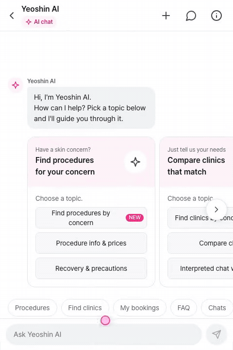
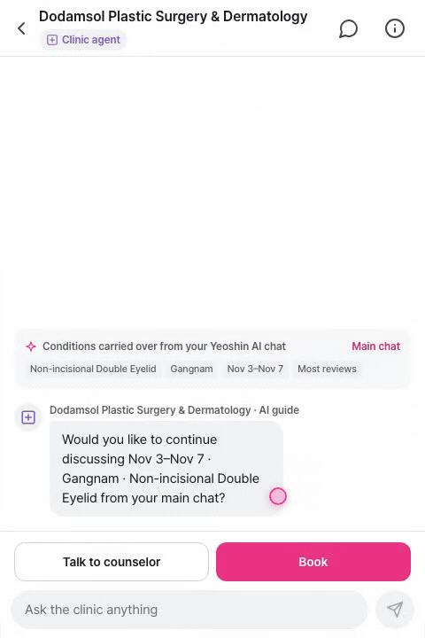
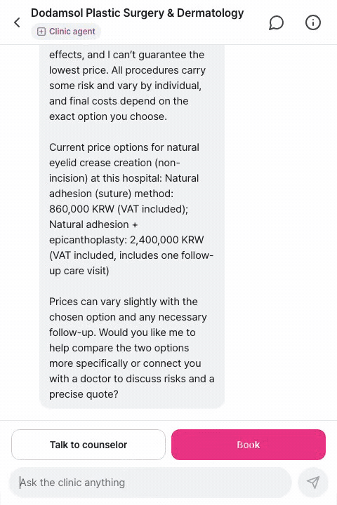
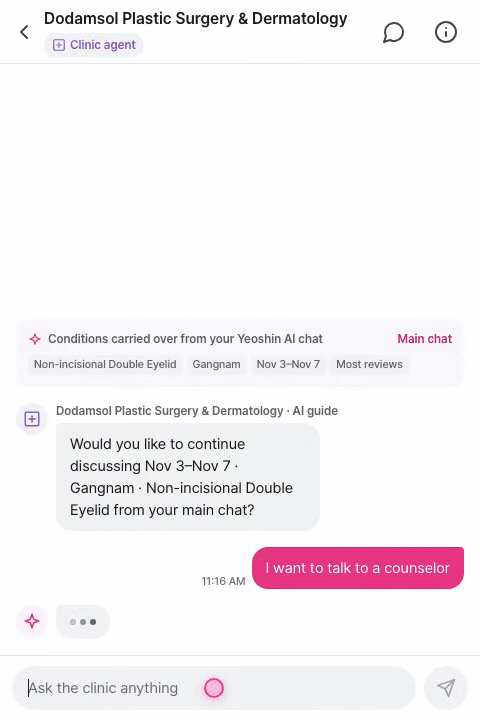
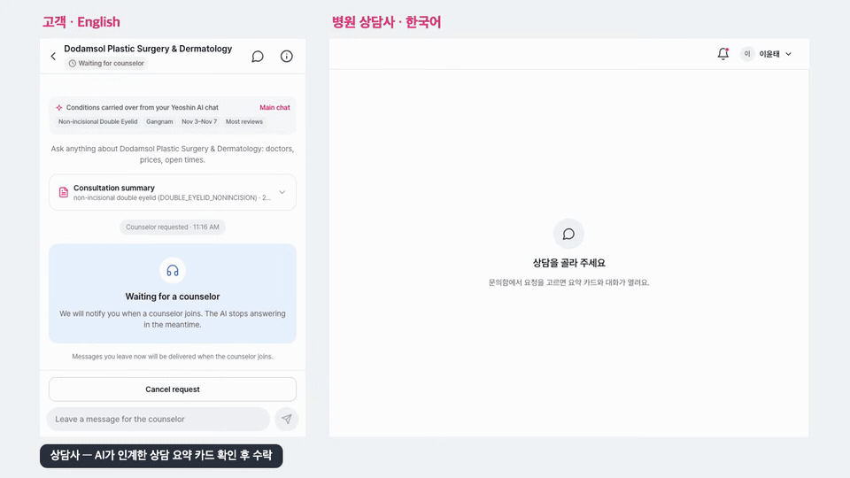
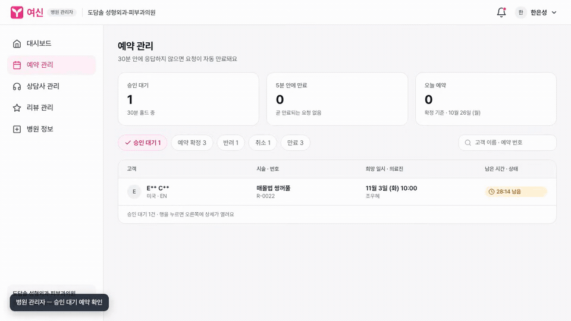
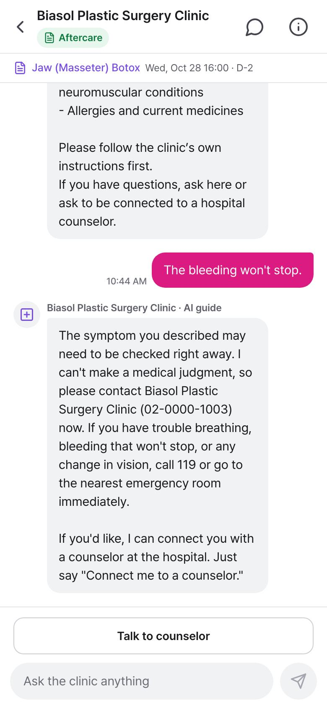
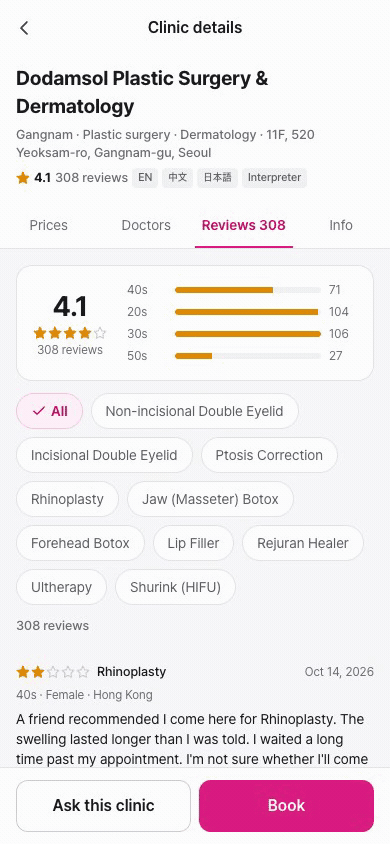
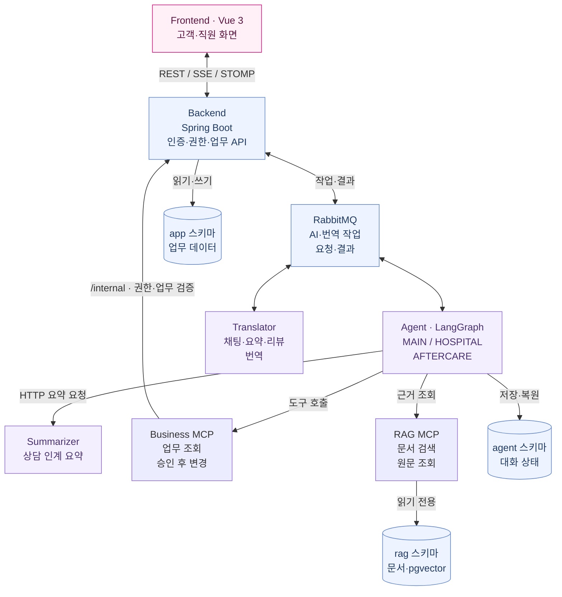
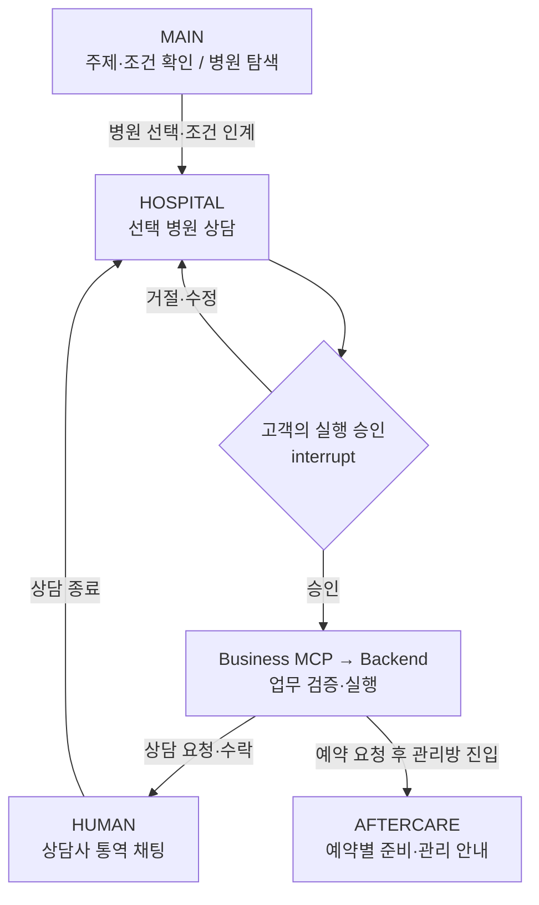

<p align="center">
  
</p>

<h1 align="center">여신 · Yeoshin</h1>

<p align="center">
  <strong>병원을 위한 외국인 환자 AI 상담·통역 플랫폼</strong><br />
  모국어로 탐색하고, 근거를 확인하고, 병원과 연결됩니다.<br />
  탐색 → 상담 → 예약 → 관리 → 후기
</p>

<p align="center">
  <a href="https://www.youtube.com/watch?v=Jh-rIKw4PNs">▶ 데모 영상</a> ·
  <a href="#why">기획 배경</a> ·
  <a href="#team">개발팀</a> ·
  <a href="#features">기능 시연</a> ·
  <a href="#architecture">아키텍처</a> ·
  <a href="#getting-started">실행 방법</a> ·
  <a href="#demo-accounts">데모 계정</a>
</p>

<p align="center">SKALA 4기 · 판교1반 1조 · AI 서비스 개발 미니프로젝트</p>

## 프로젝트 소개

**여신**은 한국 피부·성형 시술에 관심 있는 외국인 고객과 병원의 상담·예약 업무를 연결하는 **B2B2C 웹 서비스**입니다. 고객은 영어·중국어·일본어로 시술 정보를 확인하고, 자신의 조건에 맞는 병원을 비교한 뒤, AI가 정리한 상담 내용을 실제 병원 상담사에게 전달할 수 있습니다.

상담사는 한국어로 응대하고 고객은 모국어로 답변을 받습니다. 예약 요청과 병원 승인 이후에도 시술 날짜에 맞춘 준비·관리 안내, 다국어 후기까지 같은 흐름으로 이어집니다. 고객 화면은 최대 폭 390px의 모바일 웹, 상담사·병원관리자·운영자 화면은 데스크톱 업무 화면으로 구성했습니다.

> 병원은 사용자가 고른 기준으로 비교·정렬합니다. AI가 병원 우열을 추천하거나 의료 진단·효과를 보장하지 않습니다. 현재는 가상 병원·문서·계정으로 동작하는 교육용 로컬 데모이며, 결제와 실제 병원 시스템 연동은 포함하지 않습니다.

<a id="why"></a>

## 💡 왜 만들었나요?

외국인 고객은 시술 정보, 가격, 일정, 상담 창구를 오가며 같은 조건을 반복해서 설명해야 합니다. 병원은 여러 언어로 들어오는 비슷한 문의를 처리하면서, 고객이 앞서 확인한 내용과 원하는 조건까지 다시 파악해야 합니다. **정보 탐색에서 실제 병원 상담으로 넘어갈 때 맥락이 끊기는 문제**에 집중했습니다.

| 대상 | 페인포인트 | 여신의 해결 방식 | 기대하는 비즈니스 가치 |
| --- | --- | --- | --- |
| 외국인 고객 | 시술 설명과 병원 정책을 모국어로 이해하기 어렵다 | 다국어 AI 상담, 병원별 FAQ 검색, 근거 문서 확인 | 정보 확인 부담을 줄이고 상담 준비를 돕기 |
| 외국인 고객 | 가격·언어·지역·체류 일정에 맞는 병원을 비교하기 어렵다 | 같은 시술 기준의 병원 비교, 가격 옵션·VAT·예약 가능 시간 조회 | 조건 확인부터 예약 요청까지의 이탈 요인 줄이기 |
| 병원 상담사 | 같은 질문을 반복 응대하고 고객 조건을 다시 수집한다 | AI 사전 상담과 고객 동의를 받은 구조화 요약 인계 | 반복 확인을 줄이고 구체적인 상담에 집중하기 |
| 고객·상담사 | 서로 다른 언어 때문에 질문과 답변을 주고받기 어렵다 | 원문을 보존하는 실시간 통역 채팅 | 언어가 다른 고객과 상담을 이어갈 수 있는 접점 확대 |
| 병원관리자 | 상담 내용과 예약 요청이 분리되어 확인·처리가 번거롭다 | 고객·시술·가격·일시를 연결한 예약 요청과 승인·반려 화면 | 예약 상태와 처리 대상을 한곳에서 관리하기 |
| 고객·병원 | 예약 이후 준비사항과 관리 안내가 끊긴다 | 예약별 관리 채팅, 날짜별 안내·알림, 후기 작성·번역 | 방문 준비와 후속 소통을 이어가는 고객 경험 제공 |

위 항목은 **구현 기능을 바탕으로 한 기대 가치**입니다. 실제 병원의 응대 시간 절감률, 상담→예약 전환율, 고객 만족도는 아직 측정하지 않았습니다. 이번 프로젝트에서는 AI 응답 품질·응답 시간·업무 흐름의 정합성을 검증했으며, 결과는 [검증 결과](#validation)에 정리했습니다.

## 🎬 Demo

<div align="center">

[](https://www.youtube.com/watch?v=Jh-rIKw4PNs)

**[📺 여신 시연 영상 보러가기](https://www.youtube.com/watch?v=Jh-rIKw4PNs)**

썸네일이나 위 링크를 누르면 전체 시연 영상(2분 49초)이 열립니다.

</div>

| 구간 | 확인할 흐름 |
| --- | --- |
| [00:10 · AI 상담·병원 탐색](https://www.youtube.com/watch?v=Jh-rIKw4PNs&t=10s) | 시술·지역·날짜 확인 → 조건에 맞는 병원 카드 → 선택 병원 상담·근거 확인 |
| [01:04 · 답변 경계](https://www.youtube.com/watch?v=Jh-rIKw4PNs&t=64s) | 부작용·최저가 보장 요구에 대한 응답 |
| [01:12 · 예약 요청](https://www.youtube.com/watch?v=Jh-rIKw4PNs&t=72s) | 시술·가격·시간 선택 → 내용 확인 → 예약 요청 |
| [01:42 · 사람 상담사 연결](https://www.youtube.com/watch?v=Jh-rIKw4PNs&t=102s) | AI 요약 검토·공유 동의 → 상담사 인계 → 영어↔한국어 통역 채팅 |
| [02:22 · 병원 승인](https://www.youtube.com/watch?v=Jh-rIKw4PNs&t=142s) | 관리자 요청 상세 확인 → 승인 → 예약 상태 갱신 |

## 🛠️ Tech Stack


| 영역 | 기술 | 사용 목적 |
| --- | --- | --- |
| Frontend | Vue 3 · TypeScript · Vite · Pinia · vue-i18n | 역할별 화면, 대화 상태, 영·중·일·한 다국어 UI |
| Backend | Java 21 · Spring Boot 3 · Spring Security · JWT · Flyway | 인증·인가, 예약·상담·리뷰 규칙, DB 마이그레이션 |
| AI | Python · FastAPI · LangChain · LangGraph | 메인·병원·관리 대화, 도구 호출, 상태 저장·승인 재개 |
| Tool / RAG | FastMCP · PostgreSQL · pgvector | 업무 도구, 병원 범위를 제한한 문서 검색·원문 조회 |
| 비동기·실시간 | RabbitMQ · SSE · WebSocket/STOMP | AI 작업·번역 큐, 답변 스트리밍, 상담 채팅·알림 |
| 실행·관측 | Docker Compose · Prometheus · Grafana · Alloy · Loki | 로컬 통합 실행, 실험 성능 지표·컨테이너 로그 조회 |

모델은 환경변수로 변경합니다. 저장소 기본값은 메인·병원 상담 `gpt-5-nano`, 시술 정보 검색 `gpt-4.1-mini`, 준비·사후관리 `gpt-5.4-mini`, 임베딩 `text-embedding-3-small`입니다.

<a id="team"></a>

## 👥 Developers

<table>
  <tr>
    <th align="center">PM · 통합 · 검증</th>
    <th align="center">Backend · Data</th>
    <th align="center">Frontend · UI/UX</th>
  </tr>
  <tr>
    <td align="center"><a href="https://github.com/Koh-Du-Beom"><br /><b>고두범</b><br />Koh-Du-Beom</a></td>
    <td align="center"><a href="https://github.com/bethebestKR"><br /><b>마영창</b><br />bethebestKR</a></td>
    <td align="center"><a href="https://github.com/takyeonwoo"><br /><b>탁연우</b><br />takyeonwoo</a></td>
  </tr>
  <tr>
    <th align="center">AI · 메인·병원 Agent<br />RAG · 응답 성능</th>
    <th align="center">AI · 요약·번역 · 응답 성능</th>
    <th align="center">AI · 메인 상담 · 맥락 인계</th>
  </tr>
  <tr>
    <td align="center"><a href="https://github.com/Lineon24"><br /><b>이준희</b><br />Lineon24</a></td>
    <td align="center"><a href="https://github.com/dongju-shin2"><br /><b>신동주</b><br />dongju-shin2</a></td>
    <td align="center"><a href="https://github.com/seojungyoun"><br /><b>서정윤</b><br />seojungyoun</a></td>
  </tr>
</table>

역할은 팀 발표자료와 회고를, 구현 내용은 **Phase 1·2의 병합 PR**을 기준으로 정리했습니다. 아키텍처와 기능 연결은 함께 검토했으며, 아래 담당은 독점 기여를 뜻하지 않습니다.

| 팀원 | 주요 담당 및 구현 | 대표 PR |
| --- | --- | --- |
| **고두범** | 프로젝트 조율·통합 실행·검증<br />초기 Coordinator와 요약·번역 서비스 연결, MAIN/HOSPITAL 큐·승인 재개·상담 인계<br />성능 측정기·Prometheus/Grafana/Alloy/Loki, 평가 원자료·예약 정책 FAQ 조회 보완<br />데모 영상·발표 | [#21](https://github.com/skala-group-1/skala-team1-capstone/pull/21) [#22](https://github.com/skala-group-1/skala-team1-capstone/pull/22) [#25](https://github.com/skala-group-1/skala-team1-capstone/pull/25) [#28](https://github.com/skala-group-1/skala-team1-capstone/pull/28) [#30](https://github.com/skala-group-1/skala-team1-capstone/pull/30) [#81](https://github.com/skala-group-1/skala-team1-capstone/pull/81) [#82](https://github.com/skala-group-1/skala-team1-capstone/pull/82) [#91](https://github.com/skala-group-1/skala-team1-capstone/pull/91) [#93](https://github.com/skala-group-1/skala-team1-capstone/pull/93) |
| **마영창** | Backend API·JWT 인증·권한·Flyway·mock 데이터 기반<br />예약 상태 전이·슬롯 점유·알림·SSE/STOMP·업무 MCP/Agent 초기 골격<br />사후관리 Agent·준비/관리 문서·09시 안내, 리뷰 작성·번역<br />병원관리자 상담사·리뷰·병원 정보 관리 | [#1](https://github.com/skala-group-1/skala-team1-capstone/pull/1) [#2](https://github.com/skala-group-1/skala-team1-capstone/pull/2) [#3](https://github.com/skala-group-1/skala-team1-capstone/pull/3) [#5](https://github.com/skala-group-1/skala-team1-capstone/pull/5) [#50](https://github.com/skala-group-1/skala-team1-capstone/pull/50) [#54](https://github.com/skala-group-1/skala-team1-capstone/pull/54) [#60](https://github.com/skala-group-1/skala-team1-capstone/pull/60) [#63](https://github.com/skala-group-1/skala-team1-capstone/pull/63) [#66](https://github.com/skala-group-1/skala-team1-capstone/pull/66) [#90](https://github.com/skala-group-1/skala-team1-capstone/pull/90) |
| **탁연우** | Figma 기반 고객·직원 화면, 디자인 토큰·공통 UI, API·MSW 연결<br />AI 채팅·승인 카드·상담사 콘솔·예약 UX<br />선택지 칩, 세션·재연결·오류 처리, 터치 영역·키보드 포커스·다국어 글꼴<br />발표자료 | [#8](https://github.com/skala-group-1/skala-team1-capstone/pull/8) [#45](https://github.com/skala-group-1/skala-team1-capstone/pull/45) [#57](https://github.com/skala-group-1/skala-team1-capstone/pull/57) [#64](https://github.com/skala-group-1/skala-team1-capstone/pull/64) [#67](https://github.com/skala-group-1/skala-team1-capstone/pull/67) [#72](https://github.com/skala-group-1/skala-team1-capstone/pull/72) [#77](https://github.com/skala-group-1/skala-team1-capstone/pull/77) [#79](https://github.com/skala-group-1/skala-team1-capstone/pull/79) |
| **이준희** | 전체 Agent 아키텍처 설계 참여, 병원 Agent 개발·웹 채팅 연결<br />**메인 Agent 개발**: 9개 주제별 대화 설계·주제와 조건 유지·외부 시술 검색·유사 후보 선택<br />**메인 Agent 응답 성능 개선**: 프롬프트 축약, 별도 답변 검토 AI·불필요한 verify 노드 제거로 추가 처리 단계 축소<br />`hospital_id`로 범위를 제한하는 RAG 설계, 청킹·임베딩·pgvector 검색·FAQ 데이터<br />병원 리뷰 조회·다국어 요약, 상담 공유 승인 폼·재진입 복원, 예약 가격·날짜 검증<br />서비스 로고·파비콘 | [#23](https://github.com/skala-group-1/skala-team1-capstone/pull/23) [#42](https://github.com/skala-group-1/skala-team1-capstone/pull/42) [#46](https://github.com/skala-group-1/skala-team1-capstone/pull/46) [#51](https://github.com/skala-group-1/skala-team1-capstone/pull/51) [#70](https://github.com/skala-group-1/skala-team1-capstone/pull/70) [#92](https://github.com/skala-group-1/skala-team1-capstone/pull/92) |
| **신동주** | 요약·번역 흐름 고도화, 한국어 요약 카드와 다국어 구조화 요약 통일<br />메인→병원 Summarizer 연동·장애 시 초안 처리<br />추론 설정·중복 검수 축소·토큰 스트리밍·병렬 조회로 응답 개선<br />선택형 답변의 `DONE.suggestions` 추출·전송, 데모 영상 | [#47](https://github.com/skala-group-1/skala-team1-capstone/pull/47) [#65](https://github.com/skala-group-1/skala-team1-capstone/pull/65) [#78](https://github.com/skala-group-1/skala-team1-capstone/pull/78) |
| **서정윤** | 메인 상담과 선택 병원 사이의 맥락 인계 개선<br />병원 진입 시 요약 대기 축소, 기존 병원방에 최신 요약·조건 갱신<br />메인 상담을 이어가는 병원방 첫 안내, 반복 검토 실패 시 후속 질문 처리 | [#73](https://github.com/skala-group-1/skala-team1-capstone/pull/73) |

<a id="features"></a>

## 🚀 주요 기능 · GIF 시연

GIF는 실제 데모 영상의 주요 구간을 발췌·일부 배속한 화면입니다. 병원명·가격·예약·후기는 모두 가상 데이터입니다. 전체 맥락은 [데모 영상](https://www.youtube.com/watch?v=Jh-rIKw4PNs)에서 확인할 수 있습니다.

### 1. 모국어 AI 상담과 조건 기반 병원 탐색

피부 고민, 시술 정보, 회복·주의사항, 병원 탐색·비교, 통역 상담, 예약 요청·조회·취소의 **9개 시작 주제**를 제공합니다. 선택한 주제와 기존 조건을 유지하면서 부족한 정보를 묻고, 사용자가 병원 탐색을 원하면 실제 업무 도구로 병원을 조회합니다.

시술·지역·날짜·예산·상담 언어를 조건으로 탐색하며, 사용자가 고른 최대 3개 병원의 가격 옵션·VAT·언어·예약 가능 시간·후기를 같은 시술 기준으로 비교할 수 있습니다.

<p align="center"></p>

### 2. 선택 병원의 AI 상담과 근거 문서

병원을 선택하면 메인 상담에서 확인한 조건을 병원 대화로 전달합니다. 가격·의사·예약 가능 시간·리뷰는 Business MCP로, 병원 정책과 FAQ는 RAG MCP로 조회합니다. 검색은 **현재 병원 문서와 공통 문서로 범위를 제한**하며, 반환된 근거는 문서명·절·원문으로 확인할 수 있습니다.

<p align="center"></p>

### 3. 예약 요청과 상담 요약 공유

| 예약 내용 확인·요청 | AI 요약 검토·상담사 연결 |
| :---: | :---: |
|  |  |
| 시술·가격·일시를 확인한 뒤 요청합니다. 요청된 시간은 30분간 점유되며 **병원 승인 후 확정**됩니다. | 확인된 시술·희망 일정·체류·예산·질문을 요약합니다. **고객이 공유에 동의한 뒤** 상담사에게 전달합니다. |

AI를 통한 예약·취소·상담 요청은 LangGraph `interrupt`에서 고객의 실행 승인을 기다립니다. 고객의 실행 승인과 병원관리자의 예약 확정은 별도 단계입니다.

### 4. 사람 상담사와 실시간 통역 채팅

고객은 모국어로, 상담사는 한국어로 대화합니다. 상담사는 인계받은 한국어 요약을 확인하고 응대하며, 메시지의 원문·번역을 함께 조회할 수 있습니다. 상담 중에는 AI의 자동 답변을 멈추고, 상담 종료 후 해당 AI 대화로 돌아갑니다.



### 5. 병원관리자 업무 화면

승인 대기 예약과 만료까지 남은 시간을 확인하고, 시술·의료진·가격·일시를 검토해 승인하거나 반려합니다. 상담사 계정 관리, 리뷰 답글·숨김, 병원 정보·의료진 수정 화면도 제공합니다.



### 6. 예약 이후 관리와 다국어 후기

| 시술 준비·사후관리 | 후기·번역·원문 확인 |
| :---: | :---: |
|  |  |
| 승인 대기·확정 예약별 관리방에서 시술 전 준비와 이후 관리를 안내합니다. 시술 7일 전부터 30일 후까지 매일 오전 9시 안내·알림을 연결합니다. | 본인 확정 예약당 후기 1개를 작성할 수 있습니다. 시술별 조회, 고객 언어 번역·원문 보기, 병원 답글을 제공합니다. |

준비·관리 안내는 18개 시술의 문서 36개를 사용합니다. 등록된 위험 표현이 감지되면 의료 판단을 생성하지 않고 병원·119·응급실 안내와 상담사 연결 경로를 고정 문구로 제공합니다.

<details>
<summary>화면 자료 출처</summary>

- `ai-search.gif` · `hospital-rag.gif` · `booking.gif` · `handoff.gif` · `translation.gif` · `admin.gif`: 팀 데모 영상에서 발췌. 각각 00:14~00:36, 00:40~00:58, 01:13~01:35, 01:42~01:51, 01:53~02:17, 02:22~02:39 구간입니다. GIF 재생 속도는 원본과 다를 수 있습니다.
- `aftercare.png`: 팀 제공 `SKALA AI Capstone Project UI_UX Design.pdf` 7쪽의 실제 앱 화면을 추출했습니다.
- `reviews.gif`: 현재 저장소의 프론트를 MSW·가상 seed 데이터로 실행해 직접 녹화했습니다. 화면 동작을 보여주는 자료이며 실제 번역 API의 실행 영상은 아닙니다.

</details>

<a id="architecture"></a>

## 🏗️ 시스템 아키텍처

### 전체 서비스 구성

화면은 Backend를 통해 업무 기능과 AI를 사용합니다. Backend는 인증·권한·업무 상태를 확정하고, AI·번역 작업은 RabbitMQ로 위임합니다. Agent가 업무 데이터를 변경할 때도 **MCP → Backend** 경로를 따릅니다.



- **상시 서비스 9개**: frontend, backend, agent, business-mcp, rag-mcp, translator, summarizer, postgres, rabbitmq.
- `coordinator/`, `concierge/`, `aftercare/`는 역할별 Python 패키지이며 **하나의 agent 런타임**에서 실행합니다.
- 초기화 작업 `db-access`는 DB 계정·권한을 준비하고, `rag-index`는 문서를 색인합니다. 모델·검색·임베딩 호출은 AI 서비스와 RAG 계층이 담당합니다.
- 모니터링은 별도 Compose로 실행합니다. Prometheus는 실험 지표를, Alloy·Loki는 서비스 로그를 수집하고 Grafana에서 조회합니다. [설정·실행 안내](infra/monitoring/README.md)

### 대화 모드와 승인 흐름



위 그림은 병원 상담의 대표 경로입니다. 사후관리방에서도 요약 공유·고객 승인 후 상담사로 연결할 수 있으며, 상담이 끝나면 `AFTERCARE`로 복귀합니다.

| 역할 | 근거·도구 | 핵심 처리 |
| --- | --- | --- |
| Coordinator (`MAIN`) | Business MCP + 외부 시술 정보 검색 | 9개 상담 주제 유지, 조건 수집·유사 시술 선택, 병원 조회·인계 |
| Concierge (`HOSPITAL`) | 선택 병원의 업무 데이터 + 병원·공통 RAG | FAQ·가격·슬롯·리뷰 응답, 예약 조건 확인, 승인 대기·재개 |
| Aftercare (`AFTERCARE`) | 본인 예약 + 시술별 PREP/AFTERCARE 문서 | 시술 날짜별 안내, 일반 질문, 등록 위험 표현의 고정 안내 |
| Summarizer / Translator | 확인된 조건·대화·용어집 | 구조화 요약과 다국어 전달, 원문·번역 보존 |

### 병원별 RAG와 데이터 경계

Markdown 문서를 섹션·최대 800자 청크로 나누고, `text-embedding-3-small`의 1,536차원 벡터로 저장합니다. 검색할 때 상담방의 병원 ID를 적용해 **해당 병원 문서와 공통 문서만 대상으로 유사도를 계산**합니다. 모델이 다른 병원 ID를 제시해도 실행 계층에서 현재 병원 범위로 고정합니다.

| DB 스키마 | 저장 내용 | 접근 원칙 |
| --- | --- | --- |
| `app` | 사용자·병원·시술·가격·슬롯·예약·상담·메시지·리뷰·작업·알림 | Backend가 업무 규칙과 쓰기를 소유 |
| `agent` | LangGraph checkpoint·store | Agent 대화 상태와 승인 대기 복원 |
| `rag` | 문서·청크·임베딩 | 검색은 `rag_ro`, 색인은 `rag_indexer` 계정으로 분리 |

가격·날짜·예약 상태는 업무 조회 결과를 사용하고, 병원 정책은 해당 병원 문서에서 확인합니다. 일반 시술 정보 탐색은 외부 자료 검색을 사용하며, 병원별 RAG와 구분합니다. 자료가 없거나 조회가 실패하면 확인 필요·재시도·병원 문의 경로를 안내합니다.

## 📂 프로젝트 구조

```text
skala-team1-capstone/
├── frontend/              Vue 고객·상담사·병원관리자·운영자 화면
├── backend/               인증·권한·업무 API·SSE·STOMP·Flyway
├── agent/                 공통 State·Harness·그래프·API·AI 큐 워커
├── coordinator/           메인 상담·시술 정보·병원 탐색
├── concierge/             선택 병원 상담·FAQ·예약·승인·인계
├── aftercare/             예약별 시술 준비·사후관리
├── summarizer/            상담 요약 API
├── translator/            통역·요약·리뷰 번역 워커
├── mcp/
│   ├── business_mcp/      Backend /internal 호출 도구
│   ├── rag_mcp/           문서 적재·벡터 검색·doc:// 원문
│   └── mcp_common/        공통 설정·입출력 지원
├── data/mock/             가상 업무 데이터·RAG 문서·생성기·검증기
├── infra/                 통합 점검·성능 측정·모니터링
├── tests/eval/            AI 품질 평가셋·전후 응답·개별 판정
├── docs/                  API 보조 문서·성능 증빙·README 시연 자료
├── scripts/               장애 시연·개발 보조 스크립트
├── docker-compose.yml     전체 서비스·초기화 작업
└── docker-compose.dev.yml 내부 포트의 로컬 개발용 노출
```

<a id="getting-started"></a>

## 🚀 실행 방법

### 1. 준비 사항

- Git, 실행 중인 Docker Engine 또는 Docker Desktop, Docker Compose v2
- 모델 호출·문서 임베딩에 사용할 `OPENAI_API_KEY`와 설정 모델에 대한 접근 권한
- 전체 서비스는 Docker로 실행하므로 호스트에 Java·Node·Python을 각각 설치할 필요가 없습니다.
- 개별 개발 시에는 **Node.js 22+ / Java 21 / Python 3.12~3.13 + uv**를 사용합니다. 현재 `package.json`·`pyproject.toml` 기준입니다.

### 2. 저장소와 환경변수 준비

```bash
git clone https://github.com/skala-group-1/skala-team1-capstone.git
cd skala-team1-capstone
cp .env.example .env
```

기존 checkout에 `.env`가 있다면 덮어쓰지 말고 [`.env.example`](.env.example)의 누락 항목만 추가합니다.

| 변수 | 설정 내용 |
| --- | --- |
| `OPENAI_API_KEY` | 실제 모델·검색·임베딩 호출용 키 |
| `JWT_SECRET` | 32바이트 이상의 임의 문자열 |
| `SERVICE_TOKEN` | Backend 내부 API와 Business MCP가 공유하는 토큰 |
| `POSTGRES_DB`, `POSTGRES_USER`, `POSTGRES_PASSWORD` | 업무 DB 이름·사용자·비밀번호 |
| `DATABASE_URL` | `postgresql://agent:<비밀번호>@postgres:5432/<DB명>` |
| `RAG_DATABASE_URL` | `postgresql://rag_ro:<비밀번호>@postgres:5432/<DB명>` |
| `RAG_INDEX_DATABASE_URL` | `postgresql://rag_indexer:<비밀번호>@postgres:5432/<DB명>` |
| `LLM_PRIMARY_MODEL`, `LLM_FAST_MODEL`, `LLM_FALLBACK_MODEL` | 메인·병원 상담과 요약·번역 등에 사용할 모델 |
| `PROCEDURE_SEARCH_MODEL`, `AFTERCARE_MODEL`, `EMBEDDING_MODEL` | 시술 정보 검색·관리 안내·문서 임베딩 모델 |

세 전용 DB URL의 사용자명은 위 값으로 유지하고, 호스트는 Docker 서비스명 `postgres`, DB명은 `POSTGRES_DB`와 맞춥니다. URL 비밀번호의 특수문자는 인코딩합니다. `.env`는 Git에 포함하지 않습니다.

### 3. 전체 서비스 실행

```bash
# 설정 형식 확인 → 이미지 빌드·기동
docker compose config --quiet
docker compose up -d --build

# 서비스와 초기화 작업 상태 확인
docker compose ps -a
```

처음 실행하면 Backend의 Flyway가 스키마·seed를 적재하고 데모 계정 비밀번호를 준비합니다. 이후 `db-access`가 전용 계정·권한을 만들고 `rag-index`가 문서를 색인합니다. **상시 서비스 9개는 healthy, 일회성 작업 `db-access`·`rag-index`는 Exited (0)**이면 정상입니다. 최초 색인과 AI 사용에는 API 호출 비용이 발생합니다.

| 접속 대상 | 주소 | 용도 |
| --- | --- | --- |
| 웹 서비스 | http://localhost | 계정 역할에 따라 고객·직원 화면으로 이동 |
| Backend API 문서 | http://localhost:8080/swagger-ui | 로그인·업무 API 확인 |

```bash
# 기동 오류 확인
docker compose logs --tail=100 backend db-access rag-index agent

# 가상 병원 50개 적재 확인
docker compose exec postgres sh -c 'psql -U "$POSTGRES_USER" -d "$POSTGRES_DB" -c "select count(*) from app.hospitals;"'

# 종료 — DB 볼륨은 유지
docker compose down
```

### 4. 로컬 개발·문제 해결

<details>
<summary>내부 포트, 화면만 실행하기, DB 초기화 안내</summary>

**내부 서비스에 호스트에서 접속할 때** 개발용 Compose를 함께 사용합니다.

```bash
docker compose -f docker-compose.yml -f docker-compose.dev.yml up -d --build
```

| 서비스 | 로컬 포트 |
| --- | --- |
| PostgreSQL | 5432 |
| RabbitMQ / 관리 콘솔 | 5672 / http://localhost:15672 |
| Agent / Business MCP / RAG MCP | 8000 / 9101 / 9102 |
| Translator / Summarizer | 8001 / 8002 |

내부 포트는 `127.0.0.1`에만 노출합니다. 기본 Compose는 Frontend 80·Backend 8080만 공개합니다.

**Backend·API 키 없이 화면을 확인할 때**는 프론트의 MSW 모드를 사용합니다.

```bash
cd frontend
npm ci
VITE_USE_MSW=true npm run dev
# http://localhost:5173
```

MSW는 가상 응답을 사용하는 UI 개발 모드입니다. 실제 AI·번역·예약 업무의 통합 실행은 위 전체 서비스 구성을 사용합니다. 실제 Backend와 붙이는 프론트 개발은 `VITE_USE_MSW=false npm run dev`로 실행합니다.

**DB만 먼저 적재할 때**:

```bash
docker compose up -d postgres rabbitmq
docker compose run --rm db-seed
```

`postgres`만 실행하면 업무 데이터는 비어 있습니다. `db-seed`만 실행한 경우 데모 로그인 비밀번호가 준비되지 않으므로, 로그인이 필요하면 Backend도 실행해야 합니다.

- `required variable ... is missing`: 기존 `.env`에 세 DB URL과 API 키가 모두 있는지 확인합니다.
- `db-access` 인증 오류: 이 작업은 기존 계정의 비밀번호를 덮어쓰지 않습니다. 재사용 DB의 실제 비밀번호와 URL을 맞춥니다.
- `rag-index` 실패: API 키·임베딩 모델 접근 권한·DB 설정을 확인하고 `docker compose up -d --build`로 다시 기동합니다.
- 예약 시간이 없음: seed의 예약 가능 기간은 **2026-10-22~2026-11-30(KST)**입니다. 다른 날짜로 시연하려면 [데이터 생성 안내](data/mock/README.md)에 따라 생성기와 검증기를 사용합니다.
- seed를 다시 생성해 Flyway 체크섬이 달라진 경우, 데이터를 보존할지 먼저 결정합니다. `docker compose down -v`는 기존 DB 전체를 삭제하므로 초기화가 필요한 경우에만 사용합니다.

</details>

<a id="demo-accounts"></a>

## 🔐 데모 계정

**공통 비밀번호: `Passw0rd!`** · 로컬 가상 데이터 전용입니다. Backend 시작 시 `PasswordSeeder`가 BCrypt 해시를 준비합니다.

| 역할 | 이메일 | 언어·소속 | 로그인 후 화면 |
| --- | --- | --- | --- |
| 고객 | `customer.en1@demo.local` · `customer.en2@demo.local` | 영어 | `/` |
| 고객 | `customer.zh1@demo.local` · `customer.zh2@demo.local` | 중국어 | `/` |
| 고객 | `customer.ja1@demo.local` · `customer.ja2@demo.local` | 일본어 | `/` |
| 고객 | `customer.ko1@demo.local` | 한국어 | `/` |
| 상담사 | `counselor.h1@demo.local` | 한국어 · 도담솔 성형외과·피부과의원(1) | `/counselor` |
| 상담사 | `counselor.h2@demo.local` | 한국어 · 새봄결 피부과의원(2) | `/counselor` |
| 상담사 | `counselor.h3@demo.local` | 한국어 · 비아솔 성형외과의원(3) | `/counselor` |
| 병원관리자 | `admin.h1@demo.local` | 도담솔 성형외과·피부과의원(1) | `/hospital-admin` |
| 병원관리자 | `admin.h2@demo.local` | 새봄결 피부과의원(2) | `/hospital-admin` |
| 병원관리자 | `admin.h3@demo.local` | 비아솔 성형외과의원(3) | `/hospital-admin` |
| 운영자 | `operator@demo.local` | 전체 운영 | `/ops` |

### 빠르게 체험하는 순서

1. 고객 `customer.en1@demo.local`로 로그인해 AI에게 시술·지역·방문 날짜를 알려주고 병원을 탐색합니다.
2. 상담사·관리자 계정이 준비된 **1번 병원(도담솔)**을 선택해 FAQ·가격·예약 가능 시간을 확인합니다.
3. 예약 내용을 확인해 요청하고, 상담사 연결을 선택해 요약 공유에 동의합니다.
4. 별도 브라우저 프로필에서 `counselor.h1@demo.local`로 로그인해 문의를 수락하고 한국어로 답변합니다.
5. 다른 프로필에서 `admin.h1@demo.local`로 로그인해 해당 예약을 승인합니다.
6. 고객 화면에서 예약 상태·알림·관리 채팅을 확인합니다. 본인 확정 예약에서 후기 작성도 가능합니다.

같은 병원 번호의 상담사·관리자 계정을 사용해야 해당 요청을 볼 수 있습니다. 동일 브라우저의 계정 전환은 기존 세션을 정리하므로 동시 시연에는 서로 다른 프로필을 사용합니다.

<a id="validation"></a>

## 📊 검증 결과

Phase 1과 개선 후 AI 코드를 같은 입력·업무 서버·MCP·DB에서 비교한 **기존 검증 기록**입니다. 모델은 `gpt-5-nano`, 프롬프트는 `P-PHASE1` → `P-FINAL-0.8`, 실행일은 2026-10-23입니다.

| 항목 | 개선 전 → 개선 후 | 범위·판정 기준 |
| --- | --- | --- |
| AI 품질 · 문항 충족 | **15/20 → 20/20** (75% → 100%) | 고정 20문항, 동일 문항 3회 중 2회 이상 필수조건 충족 |
| AI 품질 · 개별 응답 충족 | **46/60 → 58/60** (76.7% → 96.7%) | 전후 총 120응답 개별 판정 |
| 영어 피부 고민 첫 질문 · 완료 p95 | **24.665 → 0.068초** | 첫 질문 고정 분기를 포함한 대표 입력, 각 10회·동시성 1 |
| 중국어 시술 방식 확인 · 완료 p95 | **23.568 → 5.141초** | 대표 입력, 각 10회·동시성 1 |
| 기능 회귀 | Agent 451 · 업무 API 67 · MCP 56 · 번역 23 통과 | 모델·외부 도구 응답을 고정한 기능 검사 |
| 화면·안내 분기 | 화면 6건 · 위험 표현 14/14 · 일반 문의·부정 표현 8/8 | 고정 시나리오·입력셋 |

문항 충족은 의료적 정확도나 모든 질문에 대한 성공률을 뜻하지 않습니다. 과반 집계 기준은 실행 후 개정해 전후 응답에 동일하게 적용했으며, 3회 모두 충족한 문항은 개선 후 18/20입니다. 응답 시간은 두 입력의 API·SSE 완료 구간 측정이며 전체 서비스 평균이나 동시 접속 성능으로 일반화하지 않습니다.

- [AI 평가셋·전후 응답·120건 판정](tests/eval/README.md)
- [성능 비교 절차](docs/performance/experiment-protocol.md) · [별도 60회 실측 보고서](docs/performance/report-2026-10-22.md) · [원자료·화면 증빙](docs/performance/evidence/README.md)
- [전체 서비스 통합 확인 절차](infra/README.md)

<details>
<summary>개발 검증 명령어</summary>

저장소 루트에서 실행합니다. Backend 통합 테스트에는 실행 중인 Docker가 필요합니다. 실제 DB·MCP를 사용하는 선택 테스트는 각 모듈 README의 별도 환경변수 설정이 필요합니다.

```bash
# 가상 데이터·참조 무결성
python3 data/mock/validate.py

# 프론트 타입 검사·빌드
npm --prefix frontend ci
npm --prefix frontend run build

# Python 모듈 테스트
(cd agent && OPENAI_API_KEY='' uv run --frozen pytest -q)
(cd mcp && uv run --frozen pytest -q)
(cd translator && uv run --frozen pytest -q)
(cd summarizer && uv run --frozen pytest -q)

# Backend 통합 테스트
cd backend
./gradlew test
```

</details>

## 🗃️ 데이터와 현재 한계

업무 데이터는 [`data/mock/generate.py`](data/mock/generate.py)로 생성한 가상 데이터입니다(seed 42). 병원 50곳, 시술 18종, 의사 159명, 가격 옵션 678개, 예약 가능 시간 26,928개, 후기 8,444건과 번역 25,332건을 포함합니다. RAG 문서 158개는 시술 가이드 18·공통 4·병원 FAQ 100·준비 18·사후관리 18개로 구성됩니다.

| 현재 한계 | 후속 과제 |
| --- | --- |
| 답 가능 45응답 중 `sources` 포함은 15건, 30건은 빈 배열 | 답변 충족과 별도로 출처 반환·본문 일치 검증 강화 |
| 예약금(Q-17)·효과 보장 요구(Q-18)는 3회 중 1회 미충족 | 안내 문구·응답 완결성 보완 및 반복 평가 |
| AI 품질 평가는 병원 1곳 FAQ·20문항, 영어 15·중국어 3·일본어 2문항 | 다병원·다국어·미사용 질문으로 평가 확대 |
| 응답 시간은 대표 2입력·각 10회·동시성 1 | 동시 접속·부하 측정과 내부 지연 구간 분리 |
| 상담사 답변 초안·운영자 중심 상담사 상태 관리·상담 품질 조회(TC-13~16)는 설계 범위 | 업무 흐름·인수조건을 바탕으로 후속 구현 |
| 가상 데이터 기반이며 실제 병원 연동·결제·예약금 처리는 제외 | 실제 자료·업무 정책 적용 전 별도 검증 |

병원관리자의 상담사 계정 관리·리뷰·병원 정보 수정은 구현되어 있으며, 위 TC-13~16의 직원 지원 확장 설계와는 범위를 구분합니다.

## 📚 개발 문서·협업

- 공통 규칙: [`AGENTS.md`](AGENTS.md) · 팀의 Notion **기획 v1 / 공통 계약서**를 계약 기준으로 사용합니다.
- 모듈 안내: [Backend](backend/README.md) · [Agent](agent/README.md) · [Coordinator](coordinator/README.md) · [Concierge](concierge/README.md) · [Aftercare](aftercare/README.md) · [MCP](mcp/README.md) · [Translator](translator/README.md) · [Summarizer](summarizer/README.md)
- 데이터: [생성·검증·데모 시나리오](data/mock/README.md)
- `main` 직접 push 대신 작업 브랜치와 PR을 사용합니다. 커밋은 `feat|fix|docs|chore|test(scope): 요약` 형식을 따릅니다.
- mock JSON·SQL을 직접 수정하지 않고 생성기를 수정한 뒤 재생성·검증합니다. `.env`와 API 키는 커밋하지 않습니다.

<details>
<summary>여신 로고에 담은 의미</summary>

‘여신’의 **Y와 새싹**을 결합했습니다. 새싹이 꽃으로 자라듯 자신을 가꾸어 가는 경험을 표현하며, 고객 홈·직원 화면·브라우저 파비콘에 공통으로 사용합니다. 디자인·적용: 이준희, [PR #92](https://github.com/skala-group-1/skala-team1-capstone/pull/92).

</details>
